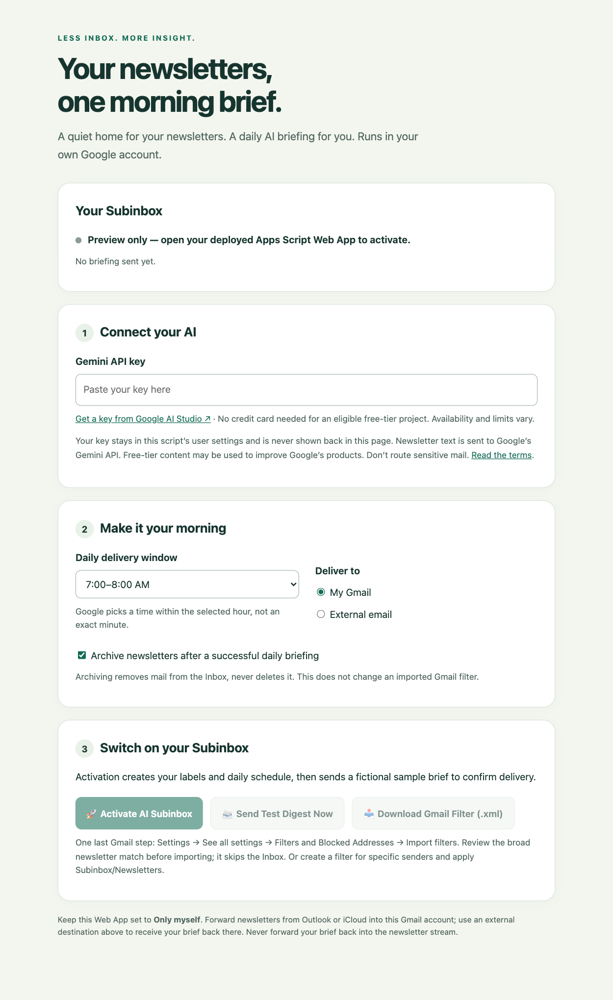

# AI Newsletter Subinbox

**Your newsletters, one morning brief.** A single file you paste into Google Apps Script. A private setup page connects Gemini, schedules a daily briefing, and sends it to Gmail, Outlook, iCloud, or another email address.

No terminal, packages, server, or code editing needed to install. You need a Google account **with Gmail**, a Gemini API key, and a desktop browser for the initial setup. Your computer can be off afterward.

> **Model:** this project uses `gemini-3.5-flash-lite`. Model availability, free-tier eligibility, and quotas can change. See [model lifecycles](https://ai.google.dev/gemini-api/docs/deprecations) and [pricing](https://ai.google.dev/gemini-api/docs/pricing).

## Setup in three steps

### 1. Copy the single file

1. Open [SubinboxAI.js](SubinboxAI.js). On GitHub, use **Copy raw file** (or open **Raw** and copy everything).
2. Open [script.new](https://script.new) while signed in to the Gmail account that will process your newsletters.
3. Replace **all** the starter code in `Code.gs` with the copied file. The name `Code.gs` is fine; no other files are needed.
4. Name the project **AI Newsletter Subinbox** and click **Save**, or press Cmd+S / Ctrl+S.

### 2. Open your private setup page

1. In the top right, choose **Deploy → New deployment**.
2. Click the gear next to **Select type** and choose **Web app**.
3. Set **Execute as → Me** and **Who has access → Only myself**. **Never make this Web App public or available to other users.** Anyone allowed to call it would act on the executing account's mailbox.
4. Click **Deploy** and complete Google's authorization flow. This script needs to read and label Gmail, send your briefing, create schedules, and call the Gemini API.
5. Open the generated **Web app URL** in your browser. Bookmark it to change settings later.

Google may show an “unverified app” warning for your personal script. Proceed only after reviewing the source and confirming you created this project yourself. Some work/school accounts block personal scripts or external API calls; use an allowed personal account rather than bypassing an administrator's policy. If **Only myself** is unavailable, do not choose a broader audience as a workaround.

### 3. Activate and route your newsletters

1. [Create a Gemini API key in Google AI Studio](https://aistudio.google.com/apikey). An eligible free-tier project does not require adding a credit card. Do not enable paid billing unless you intend to pay for usage. Read the data-use notice below before continuing.
2. In your setup page, paste the key, choose a delivery window, and choose **My Gmail** or **External email**. Check the displayed timezone. You can change it in **Apps Script → Project Settings → Time zone**; then activate again.
3. Click **Activate AI Subinbox**. It creates `Subinbox/Newsletters` and `Subinbox/Digested`, installs the schedules, and emails you a **fictional sample**. Check Spam/Junk if needed.
4. Choose which mail to route. The safest choice is a Gmail filter for specific newsletter senders: in Gmail's search options, enter the sender, choose **Create filter**, and **Apply the label → Subinbox/Newsletters**. Optionally select **Skip the Inbox**.

**Optional broad filter:** click **Download Gmail Filter (.xml)** in the wizard, or download [filters/gmail-filter.xml](filters/gmail-filter.xml). In desktop Gmail, go to **Settings → See all settings → Filters and Blocked Addresses → Import filters**, upload it, and choose **Open → Create filters** after reviewing the match. It matches “unsubscribe”, “manage preferences”, or “view in browser”, applies the newsletter label, and **skips the Inbox immediately**. Those phrases can appear in important non-newsletter mail too; review the match first. Importing twice can create duplicate Gmail filters.

**The script does not install a Gmail filter automatically.** Labels alone do not route incoming mail. You can also apply the newsletter label manually to one recent message to try the daily workflow. Do not label an entire mailbox or route confidential messages.



*Actual local rendering of the wizard, shown in preview mode. The deployed page connects to your Google account; a local preview cannot activate the workflow.*

Already activated? Reopen the bookmark, change the settings, and activate again. Leave the key blank to keep the saved key. Reactivation replaces this script's existing briefing and cleanup schedules, preserves other scripts' triggers, and sends a new sample. **Send Test Digest Now** uses saved settings and fictional source text; it does not process newsletters or prove that forwarding works.

## What happens each day

- Google runs the briefing **within** your selected hour: choosing 7 AM means approximately **7–8 AM** in the script timezone, not exactly 7:00.
- It considers messages received in the **last 24 hours** under `Subinbox/Newsletters`. If nothing new qualifies, it sends no email and makes no Gemini request.
- It strips HTML styling, images, markup, and URLs from email bodies, then sends newsletter subjects, sender fields, and cleaned text to Gemini in one batch. Attachments and linked pages are not read.
- Gemini produces categorized Markdown: **Tech & Engineering**, **Business & Finance**, and **General Reading**, omitting empty categories. The email contains an HTML rendering and a plain-text version, with 2–3 bullets requested per newsletter. AI output is not guaranteed correct or exactly one printed page.
- Only after a successful email send are messages recorded as delivered. Completely processed conversations receive `Subinbox/Digested`; the archive checkbox removes them from the Inbox. New mail in previously digested conversations can still be included.
- A weekly Sunday cleanup around 3 AM archives digested conversations whose latest message is older than 30 days, only when archiving is enabled. **Nothing is trashed or deleted. Archiving does not free Google storage.**

The downloadable filter's **Skip the Inbox** setting is independent of the archive checkbox. Unchecking the checkbox cannot undo archiving performed by Gmail filters or forwarding rules.

### Volume and delivery limits

This is intended for a small personal newsletter collection, not a bulk-mail service. Each run examines at most **100 matching Gmail conversations**, processes at most **20 messages**, and includes up to **5,000 cleaned body characters per message**. Remaining messages are not marked processed. This is a last-24-hours workflow, **not a durable backlog queue**: excess mail, a missed daily execution, or a prolonged outage can leave messages outside the window. Original mail remains available under the newsletter label.

Google Apps Script, Gmail sending, and Gemini each have [quotas](https://developers.google.com/apps-script/guides/services/quotas). Quota errors stop processing; undelivered messages are not marked digested. There are no automatic API retries. A tiny crash window between sending an email and saving its delivery record can still cause a duplicate; Gmail sending and script settings cannot be committed atomically.

No server needs maintaining, but Google can require reauthorization, change quotas, or retire a model. This is not an unconditional zero-maintenance or forever-free guarantee.

## Outlook and Apple Mail

Use a free Gmail account as the processor. Forward **only selected newsletters** there using Outlook or iCloud rules, label them in Gmail, and choose your everyday address as **External email** in the wizard.

Follow the [Outlook and iCloud forwarding guide](filters/external-clients.md). If Apple Mail already reads your Gmail account, no forwarding is needed. Server-side rules keep working with your computer off; local Apple Mail rules do not.

## Privacy and security

- Deploy **Only myself**, execute as **Me**, and keep the script project private. Never give untrusted people editor access to code that runs with your Gmail permissions.
- Your API key is stored in Apps Script **User Properties**, not in source code, HTML, or a public repository. It is sent to Gemini in an HTTPS request header. It is not a dedicated secret vault; someone who can change the script can change what it does.
- The script reads only Gmail conversations matched by its label search, but Google's Gmail authorization grants broader mailbox access. Review the source before authorizing.
- Newsletter text and sender/subject information go to Google's Gemini service. **Free-tier inputs and outputs may be used to improve Google's products and reviewed by humans.** Do not process sensitive, confidential, or personal mail. Read the [Gemini API terms](https://ai.google.dev/gemini-api/terms) and [available regions](https://ai.google.dev/gemini-api/docs/available-regions).
- The original emails stay in Gmail. Briefings go only to your configured recipient. There are no analytics, third-party fonts, CDNs, or external build dependencies.
- Source newsletters are treated as untrusted prompt data; model output is HTML-escaped before email delivery. AI can still be wrong or influenced by newsletter content. Verify important claims in the originals.

## Troubleshooting

| Symptom | Check |
| --- | --- |
| Activation rejects the key | Use an API key from AI Studio, not a Gemini app subscription. Confirm the project, region, permissions, and quota in AI Studio. |
| Gemini quota reached | Wait for quota to reset or reduce usage. Check [rate limits](https://ai.google.dev/gemini-api/docs/rate-limits); do not turn on paid billing unintentionally. |
| No daily brief | Confirm **Active** in the wizard, the correct timezone, and at least one recent, labeled message. Check **Apps Script → Executions** for failed runs. |
| Sample works, real newsletters do not | Samples use fictional text. Check the Gmail label and forwarding separately. Messages older than 24 hours are not included. |
| Activated but sample failed | The schedule can still be active. Fix Gmail permissions or sending quotas, then use **Send Test Digest Now**. |
| New settings do not affect a test | The test button uses saved settings. Click **Activate** first to save changes. |
| Model unavailable | Check Google's [deprecation page](https://ai.google.dev/gemini-api/docs/deprecations). The model is set once as `SUBINBOX.model` near the top of the file; use a supported free-tier text model, then redeploy. |
| Preview-only message | Open the deployed Web app URL, not a downloaded HTML page. |
| More messages than expected are archived | Review Gmail filters: the imported filter skips the Inbox even with script archiving disabled. Prefer sender-specific filters. |

**Updating the file:** replace the code in Apps Script and save. Then choose **Deploy → Manage deployments → Edit → Version: New version → Deploy** to update the bookmarked wizard. Reopen it and activate again when changing the schedule or timezone. Review and reauthorize any changed permissions. Saving alone does not update a versioned Web App.

### Stop or uninstall

1. In Apps Script, click **Triggers** (clock icon). Delete the `sendDailyNewsletterDigest` and `cleanupOldNewsletters` triggers for this project.
2. Delete the newsletter routing filter in Gmail and disable any Outlook/iCloud forwarding rule. Removing triggers does not stop Gmail filters from archiving incoming mail.
3. In **Deploy → Manage deployments**, archive the Web App deployment. To remove stored settings too, delete the Apps Script project.
4. Optionally revoke this script's access in your [Google account connections](https://myaccount.google.com/connections) and delete its Gemini API key in AI Studio. Do not revoke a shared key used by another project.

Original messages and Gmail labels are not deleted when you remove the script. Unarchive mail or remove labels manually if desired.

## For contributors

Only `SubinboxAI.js` is needed to install. The filter XML is also embedded in that file so its wizard can download it independently of this repository. Keep both XML copies consistent.

Local checks require Node.js, but users do not:

```sh
node --check SubinboxAI.js
node --test tests/workflow.test.cjs
```

The regression harness uses simulated Google service boundaries to check consumer-visible behavior: activation, safe failure, message-level deduplication, partially processed conversations, new arrivals during generation, escaped model output, and conservative cleanup. It does **not** prove real Google authorization, trigger execution, Gmail filter import, inbox delivery, or Gemini output quality. Browser smoke checks exercised desktop/mobile rendering and UI success/error states with simulated Apps Script RPC responses. No live Gemini generation or Gmail send was verified during initial development because no Gemini key or authorized Apps Script deployment was available.

For a real account smoke check, activate the deployed wizard and confirm its sample reaches the configured address. Then label one newsletter received within the last 24 hours and, in the Apps Script editor's function dropdown, select **sendDailyNewsletterDigest → Run**. Confirm a real briefing arrives, the original is labeled digested, and running it again sends no duplicate. This optional contributor check requires Gmail permissions and sends the selected newsletter text to Gemini. Finally let a scheduled execution run and check **Executions**; a manual run cannot prove scheduling.

## License

[MIT](LICENSE) · Copyright 2026 Emil Funk
